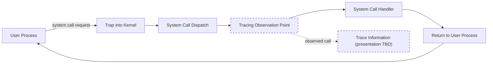
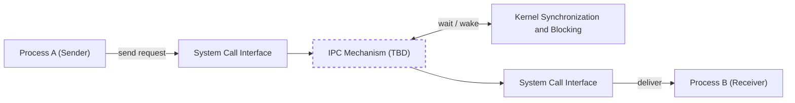
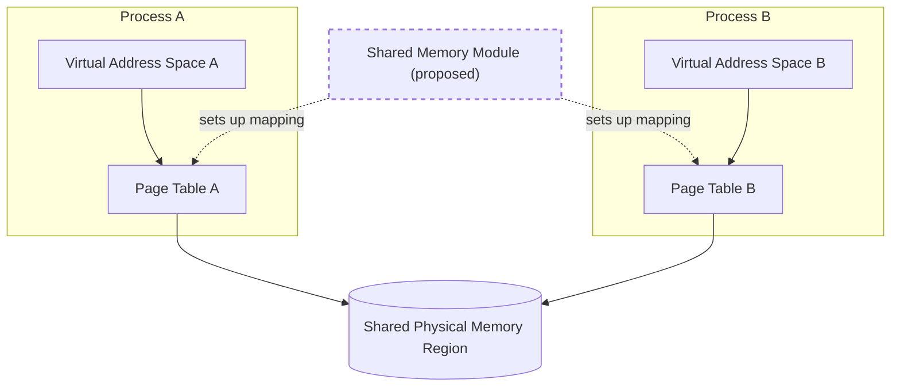
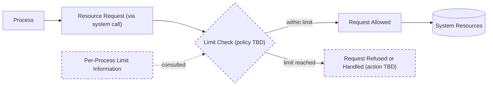
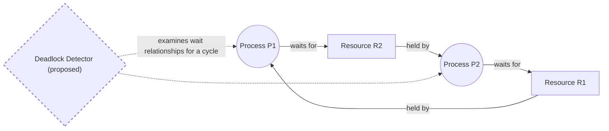
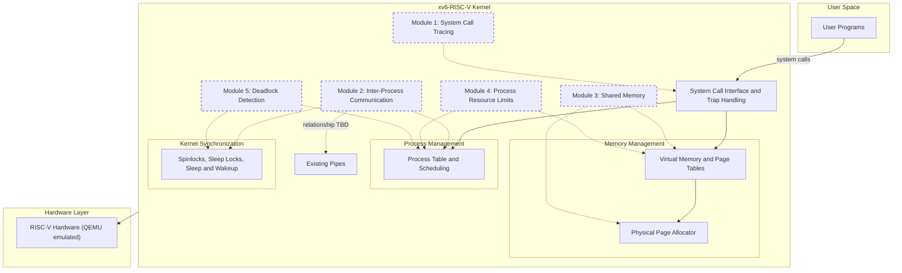
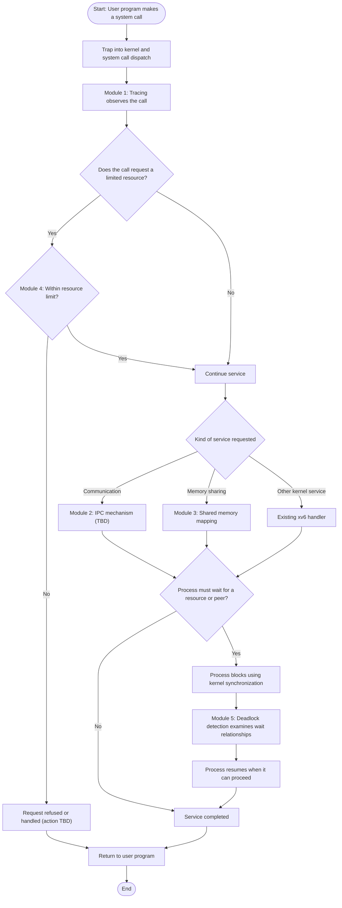

# xv6-RISC-V Kernel Extension Suite

> A university Operating Systems project that extends MIT's xv6-RISC-V educational kernel with five custom modules to study core operating system concepts through practical kernel-level work.

**Project Status:** Planning / Module Selection Finalized
**Implementation Status:** Not started

---

## Table of Contents

1. [Project Overview](#1-project-overview)
2. [Problem Statement](#2-problem-statement)
3. [Project Objectives](#3-project-objectives)
4. [Final Selected Modules](#4-final-selected-modules)
5. [Individual Module Explanations](#5-individual-module-explanations)
6. [Overall System Architecture](#6-overall-system-architecture)
7. [Overall Working Flow](#7-overall-working-flow)
8. [xv6 Component Mapping](#8-xv6-component-mapping)
9. [Relationship Between Modules](#9-relationship-between-modules)
10. [Learning Outcomes](#10-learning-outcomes)
11. [Proposed Development Plan](#11-proposed-development-plan)
12. [Testing Strategy](#12-testing-strategy-planned-not-completed)
13. [Expected Demonstration](#13-expected-demonstration)
14. [Technologies](#14-technologies)
15. [Conceptual Project Structure](#15-conceptual-project-structure)
16. [Scope and Limitations](#16-scope-and-limitations)
17. [Current Project Status](#17-current-project-status)

---

## 1. Project Overview

This project is based on **xv6-RISC-V**, the re-implementation of the Unix Version 6 operating system developed at MIT for teaching. It targets the **RISC-V** architecture and is distinct from the older x86-based version of xv6. The official sources are available at:

- Kernel source: <https://github.com/mit-pdos/xv6-riscv>
- Companion book: <https://github.com/mit-pdos/xv6-riscv-book>

xv6 is small enough to be read and understood completely, yet it contains the essential structure of a Unix-like kernel: processes, virtual memory, system calls, traps, locking, a file system, and pipes. This makes it well suited for learning operating system internals by modifying a real kernel.

The goal of this project is to extend the existing xv6 kernel with five custom modules. Each module is meant to demonstrate an important operating system concept through practical kernel-level work.

> **Note:** This document describes the *planned* project. No module has been implemented yet. Where this document refers to existing xv6 behaviour, it is stated as such; everything else is a proposed extension.

---

## 2. Problem Statement

Operating system concepts such as system-call handling, inter-process communication, memory sharing, resource control, and deadlocks are often learned only in theory. Studying them inside a working kernel is more instructive, but the base xv6 kernel provides only a minimal set of mechanisms. It does not, in its base form, offer tools for observing system calls, general facilities for sharing memory between processes, per-process resource control, or deadlock detection.

This project addresses that gap by planning five extensions to xv6 that make these concepts concrete, observable, and testable inside a small real kernel.

---

## 3. Project Objectives

- To use MIT xv6-RISC-V as a foundation for practical operating system study.
- To document five operating system concepts and their relationship to the xv6 kernel.
- To plan extensions that integrate cleanly with xv6's existing process management, memory management, system-call infrastructure, and synchronization mechanisms.
- To clearly distinguish existing xv6 functionality from the proposed extensions.
- To establish a documented foundation on which module designs and features will be decided later.

---

## 4. Final Selected Modules

The following five modules are finalized for this project.

1. **System Call Tracing**
2. **Inter-Process Communication (IPC)**
3. **Shared Memory**
4. **Process Resource Limits**
5. **Deadlock Detection**

---

## 5. Individual Module Explanations

> In the diagrams of this document, elements shown with a **dashed border** represent *proposed* project modules or additions. Elements with a solid border represent *existing* xv6 functionality or general concepts.

### 5.1 System Call Tracing

**What the module is.**
System Call Tracing is a mechanism for observing which system calls a process makes while it runs.

**Fundamental Operating Systems concept.**
The system-call interface: the controlled boundary through which user programs request services from the kernel. Because every kernel service requested by a user program crosses this boundary, it is a natural place for observation.

**Why it is important.**
Observing system calls shows how programs actually interact with the operating system. Tools of this kind are widely used for debugging, understanding program behaviour, and analysing software.

**General working principle.**
When a user program requests a kernel service, execution enters the kernel through a trap and is routed to the matching system-call handler. Tracing places an observation point on this path, so that the request can be noted without changing the service that is provided.

**Interaction with the xv6 kernel.**
The module relates to xv6's system-call infrastructure, specifically the trap handling path and the dispatch of system calls to their handlers (in the xv6-RISC-V source, mainly `kernel/trap.c` and `kernel/syscall.c`), and to per-process information kept by the process management code. Where traced information is presented, and how tracing is turned on for a process, are TBD.

**General OS concepts demonstrated.**
User/kernel mode separation, traps, the system-call interface, and process state.

**Educational purpose.**
To let students follow the path from a user program to the kernel and back, and to see directly how user programs depend on kernel services.



**Diagram explanation.** A user process makes a system call, which traps into the kernel and is dispatched to its handler. The proposed tracing observation point sits on this path and records that the call occurred, while the handler continues to perform the service normally. Control then returns to the user process.

---

### 5.2 Inter-Process Communication (IPC)

**What the module is.**
IPC allows separate processes to exchange data or signals with each other through facilities provided by the kernel.

**Fundamental Operating Systems concept.**
Process isolation and controlled communication. Each process has its own address space and cannot read another process's memory directly, so the kernel must provide an explicit channel when cooperation is required.

**Why it is important.**
Real systems are built from cooperating processes. Without IPC, processes could not coordinate work or exchange information in a safe, kernel-controlled way.

**General working principle.**
One process hands data to the kernel through an interface; the kernel holds it in a kernel-managed channel and delivers it to another process. If the receiver is not ready, or the channel is not available, the kernel can make processes wait and later wake them. The specific IPC mechanism to be built is **TBD** and will be decided at the design stage.

**Interaction with the xv6 kernel.**
The module relates to process management (processes that block and resume), kernel synchronization (protecting shared kernel data and waiting using the existing sleep and wakeup facilities), and the system-call interface (user programs reach the module through system calls). It is also relevant that xv6 already provides one form of communication, *pipes* (implemented in `kernel/pipe.c`). This is existing xv6 functionality and is distinct from the proposed IPC module; how the module relates to pipes is TBD.

**General OS concepts demonstrated.**
Process isolation, kernel-mediated communication, blocking and wake-up, and synchronization.

**Educational purpose.**
To show how isolated processes can still cooperate, and what the kernel must do to make that safe.



**Diagram explanation.** Two isolated processes never communicate directly. Process A passes data to the kernel through system calls, the proposed IPC mechanism (still TBD) manages the exchange, and the kernel's synchronization facilities handle waiting and waking when either side is not ready. The data is then delivered to Process B.

---

### 5.3 Shared Memory

**What the module is.**
Shared Memory allows two or more processes to access the same region of physical memory through their own address spaces.

**Fundamental Operating Systems concept.**
Virtual memory and address-space isolation. Each process normally has a private virtual address space mapped by its page table to its own physical memory. Shared memory is a deliberate, kernel-controlled exception to that isolation.

**Why it is important.**
Sharing memory is one of the most direct ways for processes to exchange large amounts of data, since data does not have to be copied through the kernel for each exchange. It is a standard facility in operating systems.

**General working principle.**
The kernel arranges for page-table entries in more than one process to refer to the same physical memory. Because the processes can then modify the same data concurrently, they require a method of coordination. Details of how regions are named, attached, and released are TBD.

**Interaction with the xv6 kernel.**
The module relates to memory management: per-process page tables and virtual memory code (mainly `kernel/vm.c`), physical page allocation (`kernel/kalloc.c`), and process lifecycle handling in `kernel/proc.c`, because shared pages must be handled correctly when processes are created or terminated. Base xv6 gives each process private memory; it does not provide general memory sharing between user processes. Synchronization between users of the shared region is also relevant (TBD).

**General OS concepts demonstrated.**
Virtual-to-physical mapping, page tables, physical memory management, resource ownership, and the need for synchronization on shared data.

**Educational purpose.**
To make the relationship between virtual and physical memory concrete, and to show why sharing needs both kernel support and careful coordination.



**Diagram explanation.** Each process uses its own virtual address space and page table. The proposed module arranges for both page tables to map to the same physical memory region, so both processes can see the same data. The kernel remains responsible for the mappings.

---

### 5.4 Process Resource Limits

**What the module is.**
Process Resource Limits are restrictions on the amount of system resources that a single process may consume.

**Fundamental Operating Systems concept.**
Resource management and protection. An operating system shares finite resources, such as memory, among many processes, and should prevent one process from using more than its share to the detriment of others.

**Why it is important.**
Without limits, a faulty or misbehaving program could exhaust system resources and affect every other process. Resource control contributes to the stability, fairness, and predictability of the system.

**General working principle.**
The kernel associates limit information with a process. When the process requests a controlled resource, the kernel compares the request against the process's limit and decides whether to allow it. Which resources are limited, what the limits are, and what action follows when a limit is reached are policy decisions and are **TBD**; no policy is committed in this document.

**Interaction with the xv6 kernel.**
The module relates to process management, because per-process information is kept in the process structure (`kernel/proc.h`, `kernel/proc.c`), and to the kernel paths through which processes obtain resources, such as memory allocation (`kernel/vm.c`, `kernel/kalloc.c`) and process creation. It is also reachable through the system-call interface. Base xv6 does not provide configurable per-process limits.

**General OS concepts demonstrated.**
Resource accounting, protection and fairness, admission control, and per-process kernel state.

**Educational purpose.**
To show how a kernel keeps control of shared resources and protects the system from individual processes.



**Diagram explanation.** A process requests a resource from the kernel. The proposed limit check compares the request with the limit information stored for that process. A request within the limit proceeds to the resource; otherwise it is refused or handled in a way that is still TBD.

---

### 5.5 Deadlock Detection

**What the module is.**
Deadlock Detection is the identification of situations in which a set of processes are permanently blocked because each is waiting for a resource held by another in the set.

**Fundamental Operating Systems concept.**
Deadlock and circular wait in concurrent systems. Deadlock may occur when processes hold some resources while waiting for others, and the waiting forms a cycle.

**Why it is important.**
A deadlock makes the affected processes unable to proceed, and it can be hard to diagnose because the system may appear idle rather than failing visibly. Understanding and detecting deadlock is a central topic in concurrency.

**General working principle.**
The kernel tracks which processes hold and which are waiting for which resources. This relationship can be represented as a graph, in which a cycle indicates a deadlock. Detection checks for such cycles. Which resources are considered, when detection runs, and how a detected deadlock is reported or handled are **TBD**.

**Interaction with the xv6 kernel.**
The module relates to kernel synchronization, because xv6 uses spinlocks (`kernel/spinlock.c`) and sleep locks (`kernel/sleeplock.c`) together with sleep and wakeup facilities, and to process management, because processes are the entities that wait. Whether detection applies to kernel locks, resources introduced by other project modules, or both is TBD. Base xv6 does not include a deadlock detection facility.

**General OS concepts demonstrated.**
Mutual exclusion, hold-and-wait, circular wait, resource-allocation / wait-for graphs, and synchronization.

**Educational purpose.**
To make an abstract concurrency problem concrete and to show how the necessary conditions for deadlock can be recognised in a running kernel.



**Diagram explanation.** P1 holds R1 and waits for R2, while P2 holds R2 and waits for R1. These relationships form a cycle, which indicates deadlock. The proposed detector examines such wait relationships to recognise the cycle.

---

## 6. Overall System Architecture

The diagram below places the five proposed modules in the structure of the xv6-RISC-V kernel. Solid elements are existing xv6 areas; dashed elements are proposed project modules.



**Diagram explanation.** User programs enter the kernel through the system-call interface. The kernel's existing areas are process management, memory management, and synchronization. Each proposed module attaches to the areas it depends on (dashed arrows): tracing to the system-call path; IPC to processes and synchronization; shared memory to virtual memory and page allocation; resource limits to processes and memory; deadlock detection to synchronization and processes. The kernel runs on RISC-V hardware, emulated by QEMU for development.

---

## 7. Overall Working Flow

The diagram follows one conceptual scenario in which a user program interacts with the kernel and the proposed modules take part. It describes the intended relationships, not a finalized design.



**Diagram explanation.** Every call first passes through tracing. Calls that request a limited resource are checked against the process's limit. Permitted calls are handled by the IPC module, the shared memory module, or an existing xv6 handler. If the process has to wait, kernel synchronization blocks it and deadlock detection examines the resulting wait relationships. Finally control returns to the user program. When and how often each check happens is TBD.

---

## 8. xv6 Component Mapping

The table separates what xv6-RISC-V already provides from what this project proposes. File names refer to the existing xv6-RISC-V source tree; new files or functions that the project may create are TBD and are not listed.

| Module | Related existing xv6 area | Related existing source (xv6-RISC-V) | Existing base behaviour | Proposed extension |
|--------|---------------------------|--------------------------------------|-------------------------|--------------------|
| System Call Tracing | System-call infrastructure, trap handling | `kernel/syscall.c`, `kernel/trap.c`, `kernel/sysproc.c` | System calls are dispatched to handlers; no tracing facility in the base system | Observation of system calls (design TBD) |
| Inter-Process Communication (IPC) | Process management, synchronization, pipes | `kernel/proc.c`, `kernel/pipe.c`, `kernel/spinlock.c` | Pipes exist as one form of communication | An additional IPC module (mechanism TBD) |
| Shared Memory | Memory management, process lifecycle | `kernel/vm.c`, `kernel/kalloc.c`, `kernel/proc.c` | Each process has private memory | Kernel-controlled memory sharing (design TBD) |
| Process Resource Limits | Process management, memory allocation | `kernel/proc.h`, `kernel/proc.c`, `kernel/vm.c`, `kernel/kalloc.c` | No configurable per-process limits | Per-process limits (resources and policy TBD) |
| Deadlock Detection | Kernel synchronization, process management | `kernel/spinlock.c`, `kernel/sleeplock.c`, `kernel/proc.c` | Locks and sleep/wakeup exist; no deadlock detection | Detection of circular waits (scope TBD) |

---

## 9. Relationship Between Modules

The modules are separate topics, but they meet in the shared parts of the kernel.

| Module | Interacts with | Nature of the relationship |
|--------|----------------|----------------------------|
| System Call Tracing | All other modules | Observes system calls through which the other modules would be used; usefulness as a diagnostic aid for the other modules is expected. |
| Inter-Process Communication | Deadlock Detection | Processes that block while communicating create wait relationships that detection may consider (scope TBD). |
| Shared Memory | Process Resource Limits | Memory made available through sharing may need to be considered by memory-related limits (policy TBD). |
| Shared Memory | Deadlock Detection | Coordination of shared regions may introduce waiting between processes (TBD). |
| Process Resource Limits | Inter-Process Communication | Communication facilities may consume kernel resources that limits could apply to (TBD). |

Whether any of these relationships becomes an actual design requirement will be decided in the design stage.

---

## 10. Learning Outcomes

After completing the project, the team expects to be able to:

- Explain the structure of the xv6-RISC-V kernel and the path of a system call through it.
- Describe how isolated processes communicate and share memory under kernel control.
- Explain how virtual memory and page tables enable or restrict memory sharing.
- Explain why operating systems limit per-process resource usage.
- Describe the conditions for deadlock and how it can be detected.
- Explain kernel synchronization and its role in correct kernel code.
- Work with a real kernel in a disciplined way, including documentation and testing.

---

## 11. Proposed Development Plan

The plan is high-level. Detailed tasks, designs, and schedules will be defined later.

| Phase | Description | Status |
|-------|-------------|--------|
| 1 | Module selection and conceptual documentation | Completed (this document) |
| 2 | Study of the relevant xv6-RISC-V source and book chapters | Not started |
| 3 | Setting up the build and run environment | Not started |
| 4 | Design of each module (including decisions marked TBD above) | Not started |
| 5 | Implementation | Not started |
| 6 | Integration of modules | Not started |
| 7 | Testing and evaluation | Not started |
| 8 | Final documentation and demonstration | Not started |

Team task allocation and calendar deadlines are TBD.

---

## 12. Testing Strategy (Planned, Not Completed)

No testing has been performed because nothing has been implemented. The following approach is planned:

| Test Level | Planned Purpose |
|------------|-----------------|
| Baseline verification | Confirm that unmodified xv6-RISC-V builds and runs, so later problems can be attributed to project changes. |
| Module-level testing | Verify each module's behaviour using user-level test programs run inside xv6. |
| Regression testing | Confirm that existing xv6 functionality still works after each extension. |
| Integration testing | Check interaction between modules where relationships exist (Section 9). |
| Concurrency scenarios | Exercise cases involving waiting and contention, relevant especially to IPC, shared memory, and deadlock detection. |

Test programs, tooling, and acceptance criteria are TBD.

---

## 13. Expected Demonstration

The final demonstration is expected to:

- Introduce xv6-RISC-V and the project's five modules.
- Show xv6 running under an emulator.
- Demonstrate each module with prepared user-level programs.
- Show a scenario in which several modules take part, following the flow in Section 7.
- Distinguish clearly between existing xv6 behaviour and the project's additions.

The exact scenarios and format are TBD. No screenshots or results exist at this stage.

---

## 14. Technologies

| Area | Choice | Status |
|------|--------|--------|
| Base operating system | MIT xv6-RISC-V | Confirmed |
| Target architecture | RISC-V | Confirmed |
| Implementation language | C (as used by xv6; RISC-V assembly appears in parts of the base system) | Confirmed |
| Build system | Make (as used by xv6) | Confirmed |
| Execution and testing environment | QEMU emulation, as supported by xv6 | Confirmed |
| Toolchain version, host platform | RISC-V GNU cross-compiler toolchain; version and host platform | TBD |
| Debugging tools | TBD |
| Version control and collaboration | TBD |
| Test tooling | TBD |

*Documentation uses Markdown and Mermaid diagrams.*

---

## 15. Conceptual Project Structure

The layout below follows the general organization of the xv6-RISC-V repository. Names of any new files, functions, or directories are TBD and are intentionally not listed.

```text
xv6-riscv/                    # Base: MIT xv6-RISC-V repository
├── README.md                 # This document (project documentation)
├── Makefile                  # Existing build file
├── kernel/                   # Existing kernel source; project kernel changes are expected here (TBD)
├── user/                     # Existing user programs; project test programs may be added here (TBD)
├── mkfs/                     # Existing file-system image tool
└── docs/                     # Additional project documentation (TBD)
```

---

## 16. Scope and Limitations

**In scope**

- The five finalized modules listed in Section 4.
- Planning, documentation, and (later) implementation of these extensions within xv6-RISC-V.
- Educational demonstration of operating system concepts.

**Out of scope / limitations**

- No other modules will be added beyond the five finalized ones.
- xv6 is an educational system. This project does not aim for, and makes no claim of, production-level functionality.
- The project is based on xv6-RISC-V, not the x86-based xv6.
- Module designs, IPC mechanism, resource-limit policy, and deadlock detection scope are TBD.
- This document describes concepts and plans only; nothing is implemented.

---

## 17. Current Project Status

| Item | Status |
|------|--------|
| Overall status | Planning / Module Selection Finalized |
| Module selection | Finalized (five modules) |
| Conceptual documentation | Completed in this README |
| Design | Not started |
| Implementation | Not started |
| Testing | Not started |
| Demonstration | Not started |

| Module | Implementation Status |
|--------|-----------------------|
| System Call Tracing | Not started |
| Inter-Process Communication (IPC) | Not started |
| Shared Memory | Not started |
| Process Resource Limits | Not started |
| Deadlock Detection | Not started |
